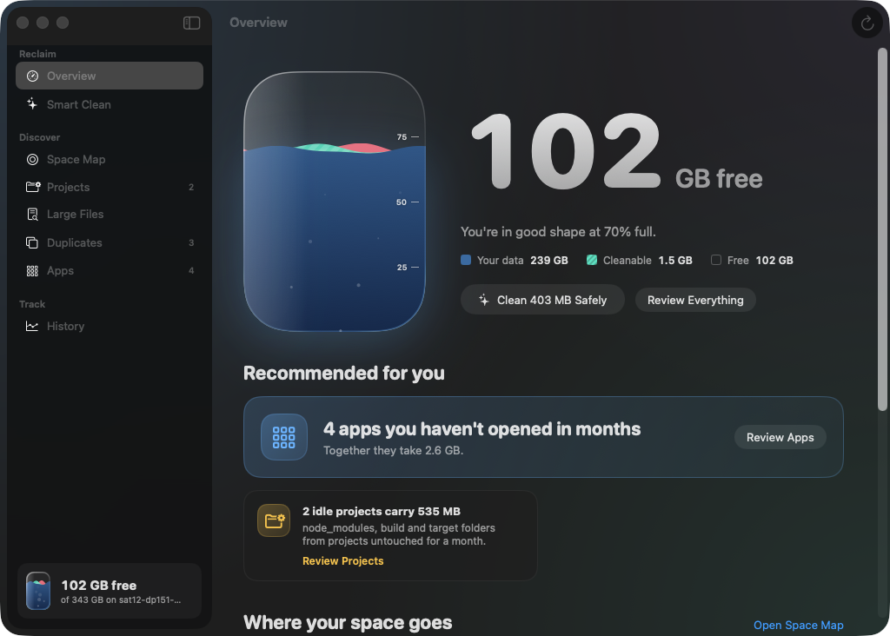
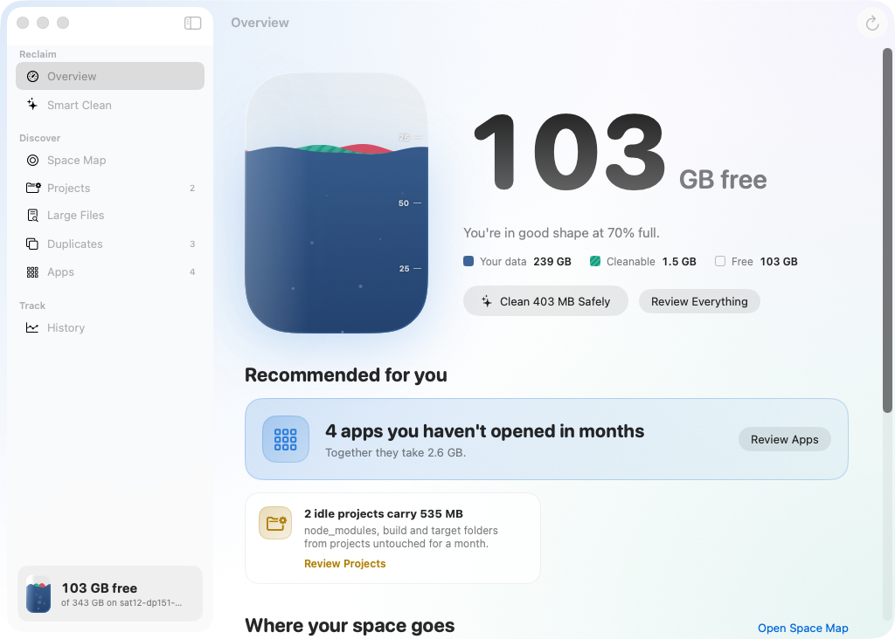
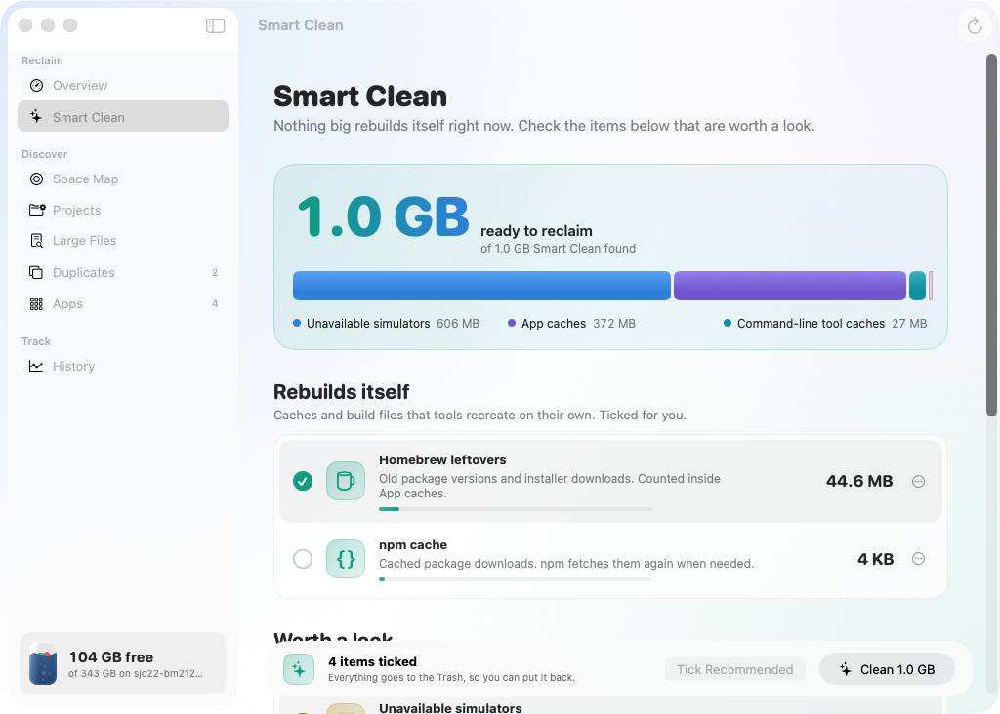
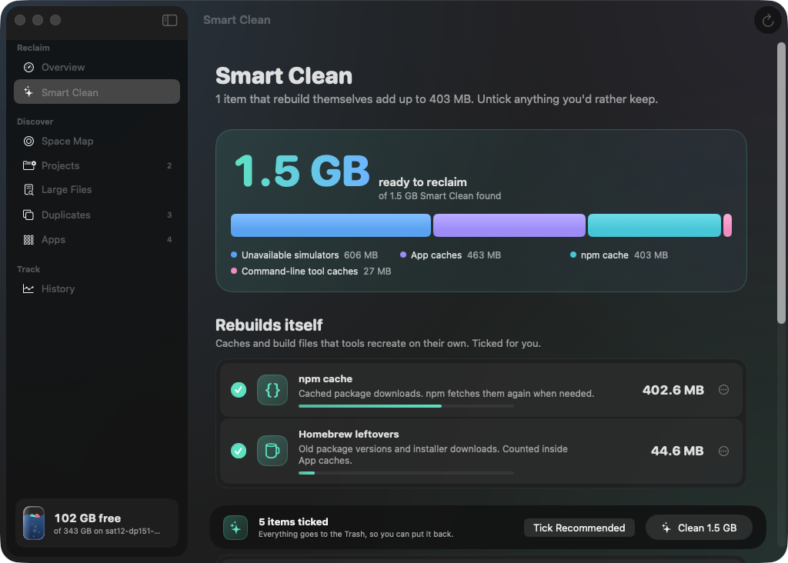
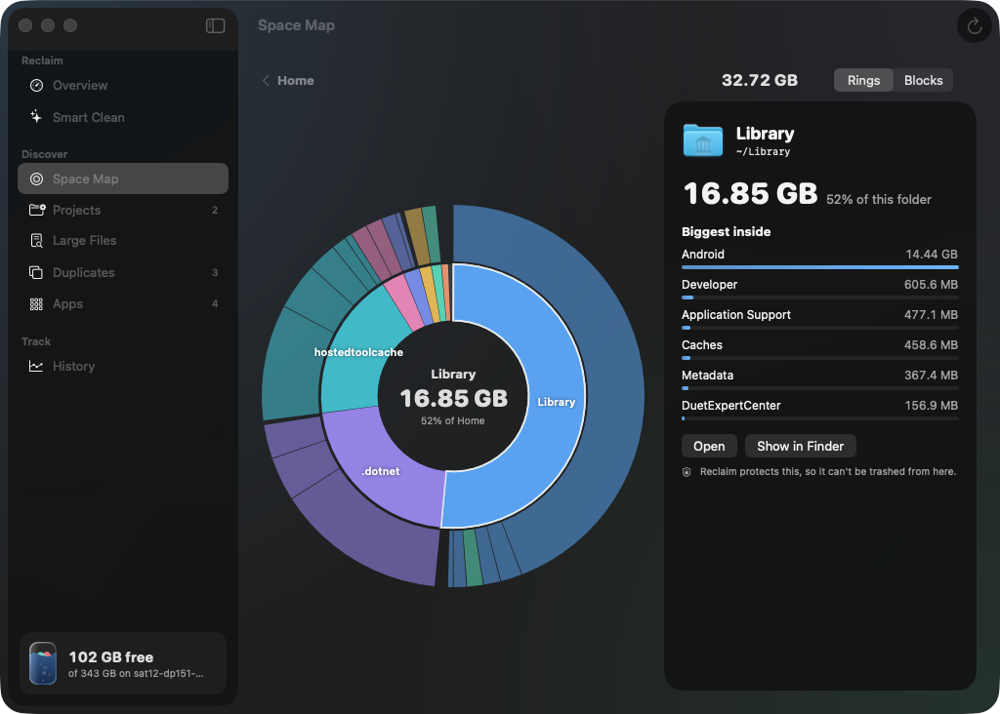
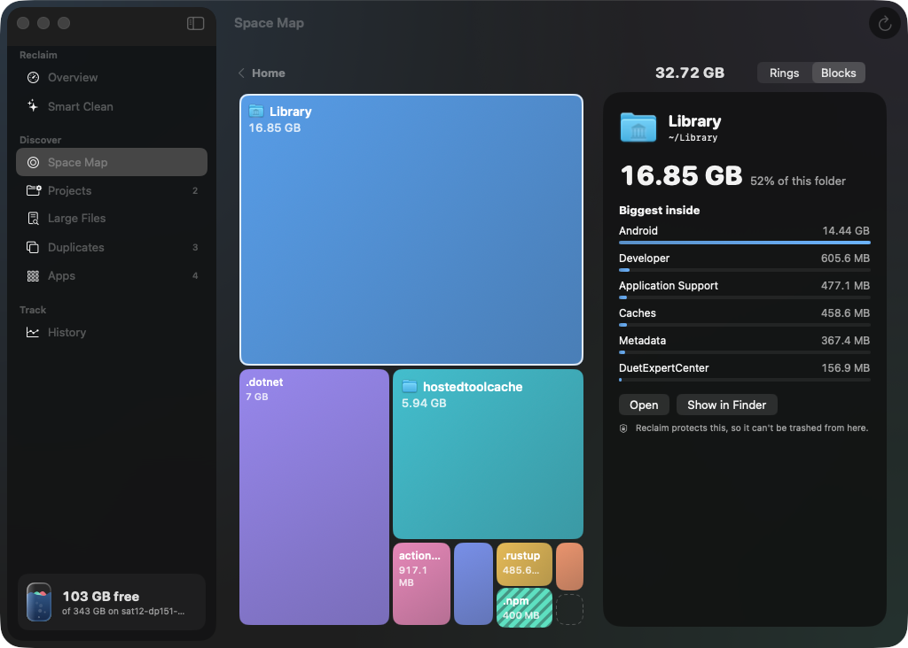
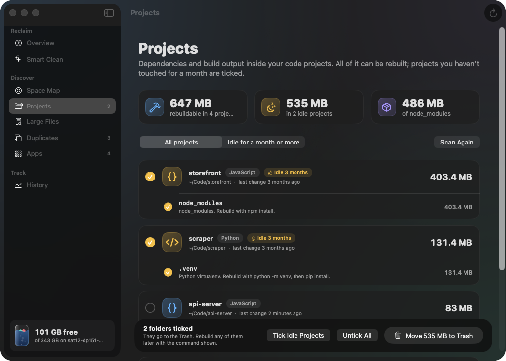
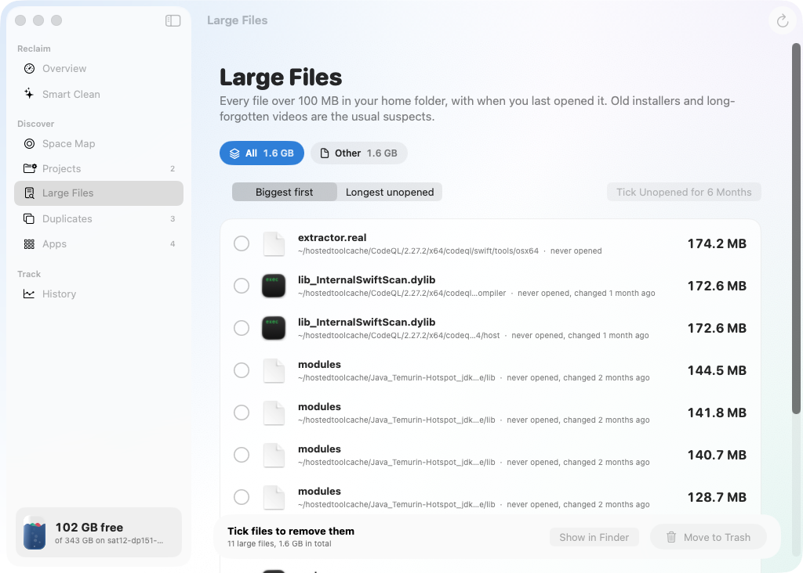
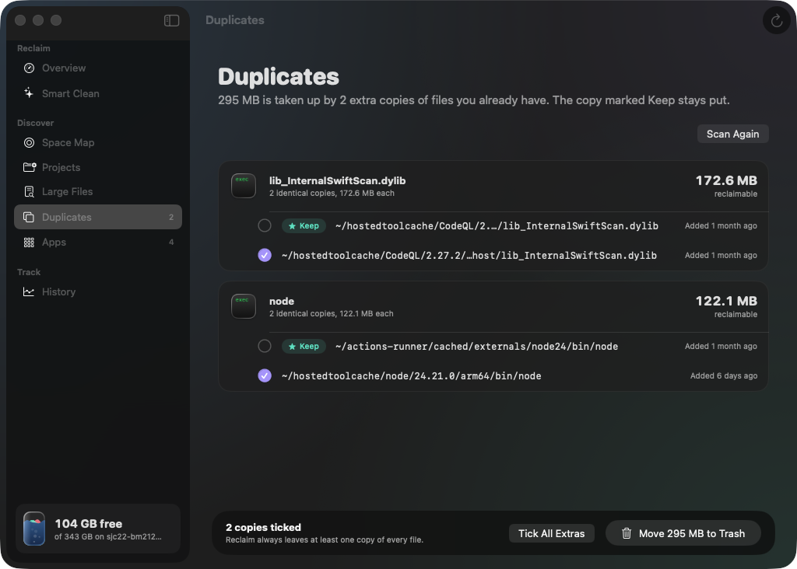
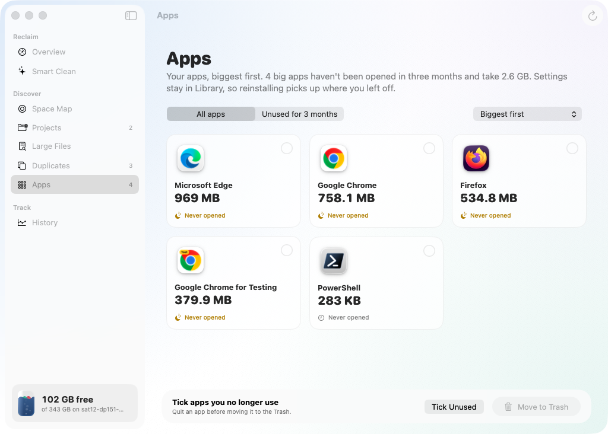

# Reclaim

[](https://github.com/whatron/reclaim/actions/workflows/build.yml)


[](https://github.com/whatron/reclaim/releases/latest)

**See what's filling your Mac, understand it, and get the space back safely.**

Reclaim is a native SwiftUI app for people whose disk keeps filling up, especially developers with Docker images, AI models, `node_modules` and Xcode build data piling up in places Finder never shows. It measures everything, explains it in plain language, ranks what's worth clearing, and does the cleaning for you. Everything it removes goes to the Trash first.

<p align="center">
  
</p>

Your disk is drawn as a glass vessel. **Deep blue water** is your data, the **glowing mint shallows** are what Reclaim can clear, **coral** is the Trash, and the **air** above is free space. Every cleanup drains the mint.

<p align="center"><sub>All screenshots were taken automatically on GitHub's macOS build machine, with a few demo code projects added, so the folders and apps shown are its own.</sub></p>

---

## Contents

- [Features](#features)
  - [Overview](#overview) · [Smart Clean](#smart-clean) · [Space Map](#space-map) · [Projects](#projects) · [Large Files](#large-files) · [Duplicates](#duplicates) · [Apps](#apps) · [History](#history-and-forecast) · [Menu bar and alerts](#menu-bar-and-alerts)
- [How Reclaim decides](#how-reclaim-decides)
- [Safety](#safety)
- [Install](#install)
- [Keyboard shortcuts](#keyboard-shortcuts)
- [Development](#development)

---

## Features

### Overview

One screen that tells you where you stand.

- **The tide gauge.** An animated vessel showing your data, what's cleanable, the Trash and free space. The water stays still if you turn on Reduce Motion.
- **A plain summary**, such as *"You're in good shape at 70% full. The biggest cleanable item is Docker at 18 GB. You can safely reclaim 12 GB right now."*
- **Recommended for you.** Suggestions ranked by how much space they'd free: idle projects, unused apps, old installers, unused AI models, the item that grew most this week, and when your disk will be full. Each comes with a one-click action.
- **Where your space goes.** Your home folder's biggest items as mini rings and bars, each with a plain-language name.

<p align="center"></p>

### Smart Clean

One click clears everything that rebuilds itself.

- Safe items over 50 MB are **ticked for you**. Anything that might still matter is grouped under *Worth a look* and never ticked automatically.
- **A live bar** fills as you tick items, so you can see what you'll get back before you click.
- **Growth badges** show how much an item grew or shrank in the past week.
- A progress banner during the clean, a short celebration with the amount freed, and a lifetime total.
- An option to empty the Trash afterwards. It asks you to type "empty" first.

<p align="center">
  
  
</p>

What it knows how to clean:

| Item | Where | How Reclaim cleans it | Ticked by default |
| --- | --- | --- | --- |
| Maven repository | `~/.m2/repository` | Moves contents to the Trash | Yes |
| Gradle caches | `~/.gradle/caches` | Moves contents to the Trash | Yes |
| npm cache | `~/.npm` | `npm cache clean --force` | Yes |
| Go module cache | `~/go/pkg/mod` | `go clean -modcache` (Go makes these read-only) | Yes |
| Homebrew leftovers | `~/Library/Caches/Homebrew` | `brew cleanup --prune=all` | Yes |
| Xcode build data | `DerivedData` | Moves contents to the Trash | Yes |
| iPhone debug symbols | `iOS DeviceSupport` | Moves contents to the Trash | Yes |
| IntelliJ snapshots | `~/IdeaSnapshots` | Moves contents to the Trash | Yes |
| Docker images and build cache | Colima or Docker Desktop disk | `docker system prune -af`, then `fstrim` inside Colima so the space actually comes back | No |
| Ollama models | `~/.ollama/models` | `ollama rm`, model by model, with unused ones flagged | No |
| App caches | `~/Library/Caches` | Moves contents to the Trash | No |
| Command-line tool caches | `~/.cache` (pip, uv, Hugging Face…) | Moves contents to the Trash | No |
| Unavailable simulators | `CoreSimulator` | `xcrun simctl delete unavailable` | No |
| Trash | `~/.Trash` | Empties it after you type "empty" | No |

Items whose folders don't exist on your Mac are hidden, and an item whose tool isn't installed says so.

### Space Map

Your home folder as interactive **rings** or **blocks**.

- **Two rings deep.** The inner ring is each folder in the current location, the outer ring is what's inside them, and big arcs are labelled.
- **Hover** to identify anything, **click** to select, **double-click** to dive in, and click the **centre** to go back up.
- **Mint** areas are things Smart Clean can clear.
- **The inspector** explains what a folder is, whether it's safe to clear, and what's biggest inside, with buttons to open it, show it in Finder or move it to the Trash.

<p align="center">
  
  
</p>

Reclaim explains folders like `.colima` (the VM behind Docker), Docker Desktop's disk, `.m2`, `.gradle`, `.npm`, Go modules, Hugging Face models, `node_modules`, `.venv`, DerivedData, iPhone backups, iCloud Drive, Mail, Messages, your Photos library, Downloads and installers. Each one is marked *Safe to clear*, *Look before deleting* or *Keep*.

### Projects

Finds forgotten dependencies and build output in your code.

- Scans your home folder for code projects and the folders they can rebuild.
- A project you haven't touched in **30 days**, judged by its own files and its git activity, is marked *Idle* and ticked.
- Each folder shows **the command that rebuilds it**, so nothing is a mystery.

<p align="center"></p>

| Ecosystem | Folders |
| --- | --- |
| JavaScript / TypeScript | `node_modules`, `.next`, `.nuxt`, `.svelte-kit`, `.turbo`, `.angular`, `.parcel-cache` |
| Rust | `target` (next to `Cargo.toml`) |
| Java / Kotlin | Maven `target`, Gradle `build` and `.gradle` |
| Scala | sbt `target` |
| Python | `.venv`, `venv` (with `pyvenv.cfg`) |
| iOS | CocoaPods `Pods` |
| Flutter / Dart | `build`, `.dart_tool` |
| C / C++ | CMake `build` |
| .NET | `bin`, `obj` |
| Terraform | `.terraform` |

A folder only counts when it sits next to the file that proves it's a build folder (`package.json`, `Cargo.toml`, `pom.xml` and so on). A random folder named `build` is left alone.

### Large Files

Every file over **100 MB** in your home folder, found instantly with Spotlight.

- Filter by **type**: videos, installers, archives, disk images, audio or other.
- See **when you last opened it** ("never opened", "opened 3 days ago"), and sort by longest unopened.
- **Smart notes** flag installers and archives sitting in Downloads, and files unopened for a year or more.
- Tick several and move them to the Trash in one go.

<p align="center"></p>

### Duplicates

Finds **true copies** by comparing contents, not names.

- Files of 20 MB or more are compared in three steps: same size, then the same first and last 64 KB, then the same SHA-256 hash.
- For each set it suggests **which copy to keep**: the one outside Downloads, with the cleanest name (no "copy" or "(1)"), and the oldest.
- It **always leaves at least one copy**, even if you tick them all.
- It skips Library, `node_modules`, `.git` and the insides of app bundles and photo libraries.

<p align="center"></p>

### Apps

Your third-party apps by size and **when you last opened them**.

- Apps over 100 MB that you haven't opened in **90 days** are flagged as unused, and one click ticks them all.
- Apple's own apps aren't listed and can't be moved.
- Your settings stay in Library, so reinstalling an app picks up where you left off.

<p align="center"></p>

### History and forecast

- Reclaim records free space **every hour** while it's running, including from the menu bar. It keeps two weeks of hourly readings and one per day for a year.
- **A chart** of free space over time. Hover to read any point.
- **A forecast.** A trend line over the last two weeks predicts the date your disk will be full.
- **What changed this week**: every item that grew or shrank by more than 100 MB.
- **An activity log** of every cleanup, with the exact output of each command it ran.

### Menu bar and alerts

- **The menu bar** shows free space. Click it for a panel with a mini gauge, the top recommendation, rescan, settings and quit.
- **Low-space alerts** notify you when free space drops below 15 GB or 7%, at most once every six hours.
- Close the window and Reclaim keeps watching from the menu bar. You can turn both off in Settings (⌘,).

---

## How Reclaim decides

| Signal | Rule |
| --- | --- |
| Ticked in Smart Clean | Rebuilds itself, over 50 MB, and its tool is installed |
| Idle project | No change to its own files or git for 30 days |
| Unused app | Over 100 MB and not opened for 90 days (Spotlight's last-used date) |
| Unused Ollama model | Not modified for 60 days |
| Old installer | A `.dmg`, `.pkg` or similar, unopened for two weeks |
| Growth badge | Changed by 100 MB or more since about a week ago |
| Forecast | Least-squares trend of free space over 14 days, shown when the disk is shrinking by 50 MB a day or more |
| Low-space alert | Under 15 GB or 7% free |

Recommendations are ranked by the space they'd free. Warnings, such as a forecast that the disk will be full within 90 days, get a boost.

## Safety

- **Everything goes to the Trash first**, the same way Finder sends it, so **Put Back** works.
- **Emptying the Trash** is the only permanent action, and you have to type "empty" to confirm it.
- **A fixed set of commands.** Reclaim only runs these: `docker system prune -af` (volumes are kept), `colima ssh -- sudo fstrim -a`, `npm cache clean --force`, `go clean -modcache`, `brew cleanup --prune=all`, `xcrun simctl delete unavailable` and `ollama rm <model>`. Running a cleanup on its own shows the exact command before anything happens.
- **Protected locations.** Your home folder, Library, Documents, Desktop, Downloads, Pictures, Movies and Music folders themselves, iCloud Drive, Mail, Messages, keychains, credential folders (`.ssh`, `.gnupg`, `.aws`, `.kube`), and the insides of Photos libraries and app bundles can never be trashed.
- **Private.** Everything runs on your Mac. Nothing is uploaded, and there are no accounts or analytics.

## Install

You need **macOS 14 Sonoma or later**.

### Download a build

**[Download the latest release →](https://github.com/whatron/reclaim/releases/latest)**

Each release, such as **Reclaim 0.1.0**, has **Reclaim-0.1.0.zip** attached under *Assets*. It's for Apple-silicon Macs; on an Intel Mac, build from source. Unzip it and drag **Reclaim** to Applications. To see which version you have, open Reclaim's Settings (⌘,).

The download isn't notarized, so the first time you open it, go to **System Settings → Privacy & Security** and click **Open Anyway**.

### Build from source

You need Xcode 16 or later, or the Command Line Tools (`xcode-select --install`).

```bash
git clone https://github.com/whatron/reclaim.git
cd reclaim
./build.sh --install     # builds, copies to /Applications, opens it
```

`./build.sh` alone builds into `build/Reclaim.app` and opens it from there.

### First launch

1. macOS asks whether Reclaim can read Documents, Desktop and Downloads. Allow it so those folders are measured.
2. For exact numbers in Library, app containers and the Trash, turn on **Full Disk Access**: System Settings → Privacy & Security → Full Disk Access, then add Reclaim. Reclaim's banner takes you to the right page. Each rebuild changes the app's signature, so after rebuilding you may need to switch Full Disk Access off and on again.

## Keyboard shortcuts

| Keys | Action |
| --- | --- |
| ⌘1 to ⌘8 | Overview, Smart Clean, Space Map, Projects, Large Files, Duplicates, Apps, History |
| ⌘R | Rescan everything |
| ⇧⌘K | Clean everything recommended |
| ⌘↩ | Clean what's ticked (Smart Clean) |
| ⌘↑ | Go up a folder (Space Map) |
| ⌘⌫ | Move the selected item to the Trash (Space Map) |
| ⌘, | Settings |

## Development

To work on the code in Xcode, open `Package.swift`.

| File | What's in it |
| --- | --- |
| `Model.swift`, `Model+Clean.swift`, `Model+Discover.swift`, `Model+Smart.swift` | App state, cleanups, discovery scans, insights, forecasting, alerts |
| `Shell.swift`, `System.swift` | Running commands, measuring with `du`, the Trash, safety rules, Spotlight |
| `Scanners.swift`, `ProjectScanner.swift`, `DuplicateFinder.swift` | Large files, apps, code projects, duplicates |
| `Knowledge.swift` | Plain-language explanations of common folders |
| `History.swift` | Hourly snapshots, compaction and the forecast |
| `Theme.swift`, `TideGauge.swift` | Colours, surfaces and the animated vessel |
| `*View.swift`, `SpaceMap.swift` | One file per page; the rings and blocks charts |
| `Tour.swift`, `Scripts/` | The automated screenshot tour used by the build check |

### Build check

`.github/workflows/build.yml` compiles the app on GitHub's macOS 26 runner on every push and publishes compiler errors and warnings as a **Compiler messages** check. Each run's page starts with a summary of the version and where to download it.

**Versions** come from the `VERSION` file, for example `0.1.0`. To make a release, change `VERSION` (say, to `0.1.1`) and merge to `main`: that build publishes a GitHub release, `v0.1.1`, with the zip attached. Other builds are labelled with the commit count, such as `0.1.0-build.31` on `main` or `0.1.0-build.31.my-branch` elsewhere, and attach their zip to the run for 14 days. Two words in a commit message switch on extras:

- `[screenshots]` sets up a few demo code projects, photographs every page in dark and light mode, and pushes the pictures to the `screenshots` branch.
- `[app]` pushes the built `Reclaim.zip` to the `app-build` branch.
